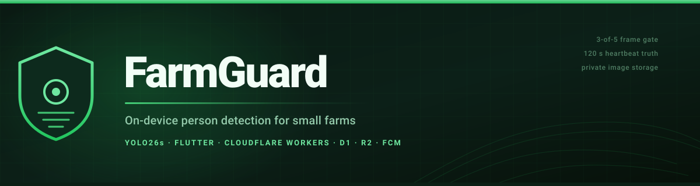
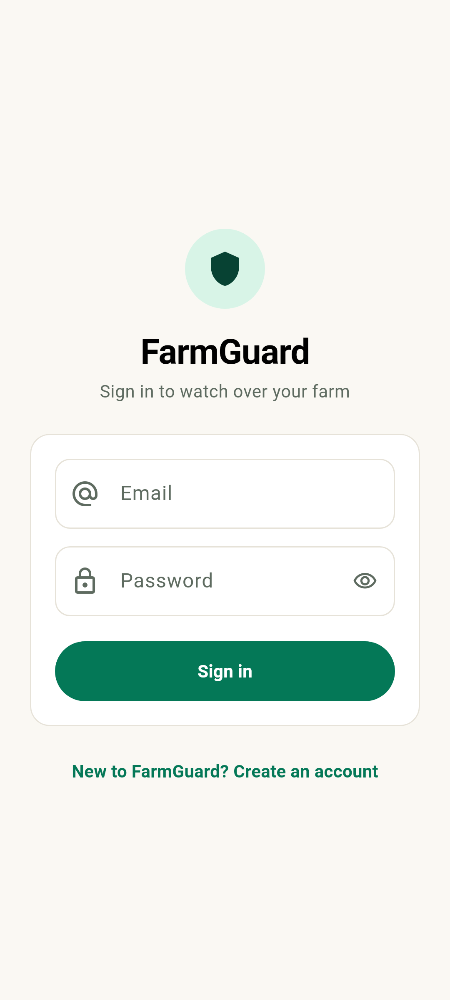
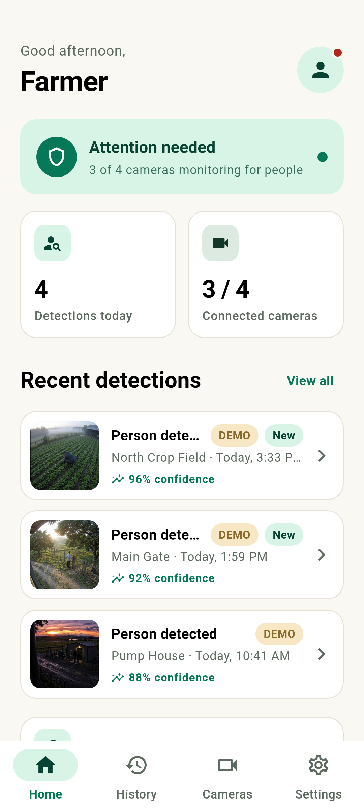
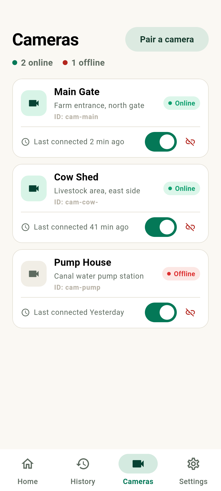
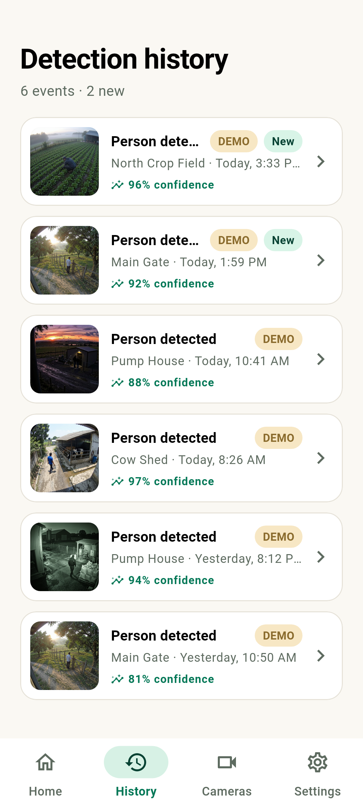
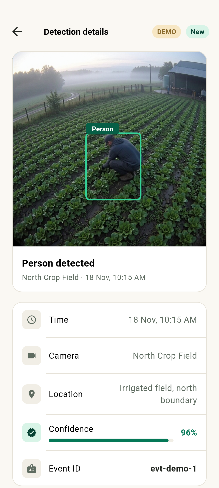
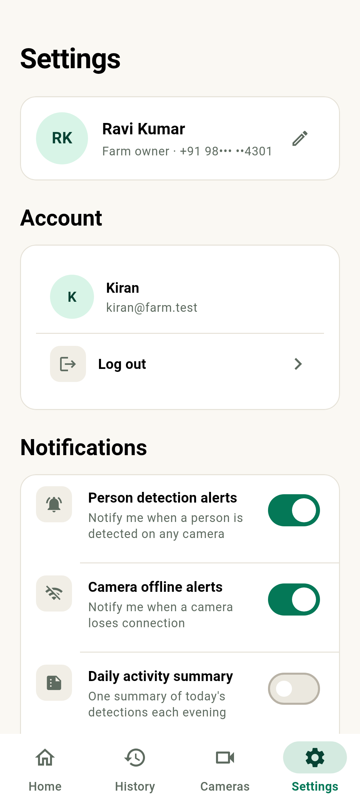
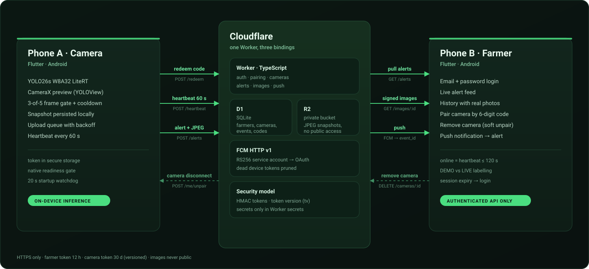

<div align="center">
  
</div>

<div align="center">


**A two-phone farm security system.** One Android phone watches the farm and runs
person detection entirely on-device. The other tells the farmer the moment something
is seen — with the photo, the camera and the time.

[How it works](#how-it-works) · [Screenshots](#screenshots) · [Architecture](#architecture) · [API](#api) · [Getting started](#getting-started) · [Docs](#documentation)

</div>

---

## The problem

Small farms cannot afford a camera operator, and they usually cannot afford a
cloud AI bill either. Continuous video streaming to a server means bandwidth,
storage, latency and a monthly invoice that grows with every camera.

FarmGuard inverts that: **the phone does the thinking.** A YOLO26s model runs on
the camera itself, so only confirmed detections ever leave the device — one
small JPEG and a few hundred bytes of JSON, per event.

| | |
|---|---|
| 🧠 **On-device inference** | YOLO26s (W8A32 LiteRT) on the camera phone. No video ever leaves it. |
| 🎯 **Deliberate detection** | 3 of the last 5 analysed frames must contain a person, then a cooldown — one alert per person, not fifty. |
| 📶 **Offline-first** | Snapshots are persisted locally and uploaded by a retrying queue. A dead network loses nothing. |
| 🔐 **Real auth** | HMAC bearer tokens, PBKDF2 passwords, single-use pairing codes, per-camera token versions. |
| 🕒 **Honest status** | A camera is online only if it heartbeated in the last 120 seconds. No optimistic UI. |
| 🧹 **Safe removal** | Removing a camera revokes its credentials but keeps every past alert and photo. |

---

## Screenshots

<div align="center">

### Farmer app

<table>
  <tr>
    <td align="center"><br><sub><b>Sign in</b></sub></td>
    <td align="center"><br><sub><b>Dashboard</b> — live feed</sub></td>
    <td align="center"><br><sub><b>Cameras</b> — status &amp; removal</sub></td>
  </tr>
  <tr>
    <td align="center"><br><sub><b>History</b> — every detection</sub></td>
    <td align="center"><br><sub><b>Alert detail</b> — photo &amp; metadata</sub></td>
    <td align="center"><br><sub><b>Settings</b></sub></td>
  </tr>
</table>

### Camera app

<table>
  <tr>
    <td align="center"><br><sub><b>Idle</b> — ready to monitor</sub></td>
    <td align="center"><br><sub><b>Pairing</b> — six-digit code</sub></td>
    <td align="center"><br><sub><b>Connection details</b></sub></td>
  </tr>
  <tr>
    <td align="center"><br><sub><b>Initializing</b> — real startup stages</sub></td>
    <td align="center"><br><sub><b>Monitoring</b> — only once native is live</sub></td>
    <td align="center"><br><sub><b>Recoverable error</b> — with retry</sub></td>
  </tr>
</table>

<sub>Screenshots are rendered from the real widget tree by a golden-image harness
(<code>tool/screenshot_test.dart</code> in each app) — not mockups.</sub>

</div>

---

## How it works

```
 Farmer taps "Pair a camera"          Camera app                     Cloudflare Worker
 ─────────────────────────────        ────────────                   ─────────────────
 6-digit code (5 min, single use) ──▶ redeem  ─────────────────────▶ binds device, mints
                                                                     camera token (tv = 1)
                                      Start Monitoring
                                      ├─ permission
                                      ├─ model load
                                      └─ first native frame ───────▶ heartbeat (now Online)
 Person walks past ─────────────────▶ 3-of-5 gate + cooldown
                                      ├─ save snapshot locally
                                      └─ queue upload ─────────────▶ alert + JPEG in R2
                                                                     │
 Farmer phone ◀────────────── FCM push (event_id) ◀─────────────────┘
              ◀────────────── GET /alerts, GET /images/:id
```

1. **Pair once.** The farmer mints a 6-digit code; the camera redeems it for a
   long-lived token. Re-pairing the same physical device is idempotent — it
   re-binds the row and bumps the token version instead of failing.
2. **Monitor.** The camera app refuses to say "Monitoring" until the native
   predictor and CameraX pipeline have actually produced a frame.
3. **Detect.** A person must appear in 3 of the last 5 analysed frames, then a
   cooldown applies. The snapshot is written to disk before any network call.
4. **Notify.** The event and JPEG are uploaded with the camera token; the Worker
   stores the image privately in R2 and pushes to every registered farmer device.
5. **Review.** The farmer opens the alert, sees the photo (fetched with their own
   token), and can remove the camera — which revokes credentials but keeps history.

---

## Architecture

<div align="center">
  
</div>

| Component | Stack | Responsibility |
|---|---|---|
| `farmguard_camera` | Flutter · CameraX · `ultralytics_yolo` · LiteRT | On-device YOLO26s inference, event gating, snapshotting, upload queue, heartbeat |
| `farmguard_farmer` | Flutter · Material 3 · Firebase Messaging | Auth, dashboard, history, camera management, push handling |
| `farmguard-backend` | TypeScript · Cloudflare Workers · D1 · R2 · FCM HTTP v1 | Auth, pairing, camera registry, alerts, private images, push fan-out |

**Why a Worker instead of a server?** The whole API is stateless request handling
around D1 and R2. Workers give global latency, zero idle cost and no server to
patch. The only external dependency is Google's FCM endpoint.

**Why no Firebase Admin SDK?** The Worker builds the RS256 service-account
assertion itself with Web Crypto and exchanges it for an OAuth token — no Node
runtime, no bundled SDK, a few hundred lines total.

---

## The parts that were hard

### 1. "Monitoring" must not be a lie

The plugin's Dart-side `onModelLoad` fires when the model *path* resolves —
before the native interpreter and camera pipeline exist. Trusting it produced a
screen that said "Monitoring" with 0.0 FPS and no video.

Now the app tracks explicit stages (`checkingPermissions → downloadingModel →
loadingModel → initializingCamera`) and only promotes to **Monitoring** on the
first native detections/metrics callback, with a 20-second watchdog that fails
recoverably instead of hanging.

### 2. A preview inside a scroll view cannot render

`Stack(fit: StackFit.expand)` needs bounded constraints. Nested in a
`SingleChildScrollView`, its height is infinite and the native view never lays
out. The preview now mounts directly in an `Expanded`; only the non-preview
cards are scrollable.

### 3. "Online" is a measurement, not a flag

A camera row is written when pairing succeeds, not when the camera is alive.
Both the API and the farmer app therefore compute status from
`last_seen_at` against a 120-second threshold, and newly paired cameras start
`offline` with `last_seen_at = NULL`.

### 4. Removing a camera must not erase the evidence

Deleting the row would orphan detection history and R2 objects. `DELETE
/api/v1/cameras/:id` is a **soft unpair**: `unpaired_at` is stamped,
`token_version` is incremented (instantly invalidating the device token), and
every past alert and photo stays readable by the farmer.

### 5. A lost response must not brick a phone

If the server committed the pairing but the client never saw the reply, the old
code would be consumed and the device identifier already registered. Redemption
now re-binds an existing device in place and issues a fresh token version, so
"just pair again" always works.

---

## API

All routes are under `https://farmguard-backend.yashsb-75.workers.dev`.

| Method | Path | Auth | Purpose |
|---|---|---|---|
| `GET` | `/api/health` | — | Liveness |
| `POST` | `/api/v1/auth/register` | — | Create farmer account |
| `POST` | `/api/v1/auth/login` | — | Farmer token (12 h) |
| `GET` | `/api/v1/auth/me` | farmer | Current farmer |
| `POST` | `/api/v1/pairing/code` | farmer | Mint a 6-digit code (5 min, single use) |
| `POST` | `/api/v1/pairing/redeem` | — | Camera exchanges code → camera token (30 d, versioned) |
| `GET` | `/api/v1/cameras` | farmer | Active cameras with computed status |
| `GET` | `/api/v1/cameras/:id` | farmer | One camera (foreign or unpaired → 404) |
| `GET` | `/api/v1/cameras/me` | camera | Camera session + masked farmer account |
| `POST` | `/api/v1/cameras/me/unpair` | camera | Camera-side disconnect |
| `POST` | `/api/v1/cameras/:id/heartbeat` | camera | Touch `last_seen_at` |
| `PATCH` | `/api/v1/cameras/:id/status` | camera | `offline` / `online` / `monitoring` |
| `DELETE` | `/api/v1/cameras/:id` | farmer | Soft unpair, history preserved |
| `POST` | `/api/v1/alerts` | camera | Idempotent event upload (triggers push) |
| `GET` | `/api/v1/alerts` | farmer | Keyset-paginated history |
| `GET` | `/api/v1/alerts/:id` | farmer | Event + camera |
| `PATCH` | `/api/v1/alerts/:id/viewed` | farmer | Mark viewed (idempotent) |
| `DELETE` | `/api/v1/alerts/:id` | farmer | Delete event (image best-effort) |
| `POST` | `/api/v1/images/:eventId` | camera | Upload JPEG (≤ 8 MiB) |
| `GET` | `/api/v1/images/:eventId` | farmer | Stream private image |
| `POST` | `/api/v1/notifications/register-device` | farmer | Register FCM token |
| `DELETE` | `/api/v1/notifications/unregister-device` | farmer | Unregister on logout |

Responses use one envelope: `{ "ok": true, "data": … }` or
`{ "ok": false, "error": { "code": …, "message": … } }`.

---

## Repository layout

```
farmguard/
├── farmguard-backend/          Cloudflare Worker
│   ├── migrations/             additive D1 schema (0001 → 0003)
│   ├── src/
│   │   ├── routes/             auth, pairing, cameras, alerts, images, notifications
│   │   ├── services/           tokens, passwords, rate limits, FCM
│   │   ├── middleware/         bearer auth, CORS
│   │   └── utils/              envelope, validation
│   └── test/                   104 Vitest cases (real workerd via Miniflare)
│
├── farmguard_camera/           Flutter app — phone that watches
│   ├── lib/screens/            home screen, startup state machine
│   ├── lib/services/           detection engine, API client, upload queue, secure storage
│   ├── test/                   153 cases
│   └── tool/screenshot_test.dart
│
├── farmguard_farmer/           Flutter app — phone in the pocket
│   ├── lib/screens/            shell, dashboard, history, cameras, settings
│   ├── lib/services/           API, repositories, FCM gateway
│   ├── assets/detections/      bundled DEMO images (always labelled DEMO)
│   ├── test/                   98 cases
│   └── tool/screenshot_test.dart
│
└── docs/
    ├── FARMGUARD-NETWORKING.md full technical report
    ├── FARMGUARD-DEMO-GUIDE.md hardware verification script
    ├── assets/                 banner, icon, architecture diagram
    └── screenshots/            README screenshots
```

---

## Getting started

### Backend

```bash
cd farmguard-backend
npm install

# Local secrets (never committed)
cp .dev.vars.example .dev.vars      # then edit AUTH_SECRET

# Local database + tests
npx wrangler d1 migrations apply farmguard-db --local
npm run typecheck && npm test

# Deploy
npx wrangler d1 create farmguard-db          # copy the id into wrangler.jsonc
npx wrangler d1 migrations apply farmguard-db --remote
npx wrangler r2 bucket create farmguard-images
npx wrangler secret put AUTH_SECRET
npx wrangler secret put FCM_SERVICE_ACCOUNT < service-account.json
npx wrangler deploy
```

### Camera app

```bash
cd farmguard_camera
flutter pub get
flutter run                 # physical Android device with a camera
```

The YOLO26s model is downloaded on first run and cached on the device. Grant
camera permission, pair with the code from the farmer app, then **Start
Monitoring**.

### Farmer app

```bash
cd farmguard_farmer
flutter pub get
flutter run
```

Firebase: create an Android app for `com.example.farmguard_farmer` in your
Firebase project, drop `google-services.json` into `android/app/`, and regenerate
`lib/firebase_options.dart` with `flutterfire configure`. Push is optional — the
app works without it, it simply receives no notifications.

> Point both apps at your own Worker by editing the base URL constant in
> `farmguard_camera/lib/services/api_client.dart` and
> `farmguard_farmer/lib/services/api/http_farmer_api.dart`.

---

## Testing

| Suite | Cases | What they prove |
|---|---:|---|
| `farmguard-backend` — Vitest + Miniflare (real workerd, real D1/R2) | **104** | Route logic, envelope shape, auth boundaries, pairing and re-pairing, token-version revocation, 120 s heartbeat freshness, soft-unpair history preservation, push fan-out |
| `farmguard_camera` — Flutter | **153** | Detection window/cooldown, upload queue and backoff, pairing response parsing, token wiring, bounded preview layout, native readiness gate + 20 s timeout, heartbeat 401 handling, connection details |
| `farmguard_farmer` — Flutter | **98** | Auth gate, repositories, online/offline freshness, remove-camera flow (confirm, cancel, failure, 401), tab routing, push sessions |
| **Total** | **355** | |

```bash
cd farmguard-backend  && npm run typecheck && npm test
cd farmguard_camera   && flutter analyze  && flutter test
cd farmguard_farmer   && flutter analyze  && flutter test
```

Regenerate the README screenshots (golden images, no device needed):

```bash
cd farmguard_farmer && flutter test tool/screenshot_test.dart --update-goldens
cd farmguard_camera && flutter test tool/screenshot_test.dart --update-goldens
```

---

## What is actually verified

| Level | Status |
|---|---|
| Implemented | ✅ all three components |
| Unit / widget tested | ✅ 251 Flutter cases with fakes, no platform channels |
| Backend integration tested | ✅ 104 cases against real workerd, D1 and R2 |
| Deployed | ✅ Worker live with D1 migrations applied, R2 private |
| **Physically verified on two phones** | ✅ pairing, live detection, image upload, push delivery, camera removal |

Physical runs were done on two Android devices against the deployed Worker:
pairing, on-device detection, alert and JPEG upload, FCM delivery to the farmer
phone, and farmer-side removal (camera drops to *Not paired* on its next
heartbeat while history survives).

---

## Limitations & next steps

- **One camera per phone**, one farmer per camera. Multi-camera accounts are a
  schema change away but not implemented.
- **Push is best-effort.** Foreground notifications are intentionally ignored;
  taps are routed to the alert. Data-only background handling is future work.
- **No account deletion endpoint.** Password reset and account removal are not
  built (documented rather than half-done).
- **Notification settings are local UI state**, not yet wired to the backend.
- **Thermals and long sessions** have no instrumentation; monitoring for hours
  on a warm phone is untested.
- **iOS is untested** — the camera pipeline is Android-first.

---

## Documentation

| Document | Contents |
|---|---|
| [`docs/FARMGUARD-NETWORKING.md`](docs/FARMGUARD-NETWORKING.md) | Full technical report: data model, API contract, security model, threat notes |
| [`docs/FARMGUARD-DEMO-GUIDE.md`](docs/FARMGUARD-DEMO-GUIDE.md) | Step-by-step hardware verification script, including a single-phone fallback |
| [`farmguard-backend/README.md`](farmguard-backend/README.md) | Worker internals, routes, deployment |
| [`farmguard_camera/README.md`](farmguard_camera/README.md) | Detection pipeline and startup state machine |
| [`farmguard_farmer/README.md`](farmguard_farmer/README.md) | App structure and push lifecycle |

---

<div align="center">
<sub>Built with Flutter, TypeScript and Cloudflare Workers. YOLO26s via <a href="https://pub.dev/packages/ultralytics_yolo">ultralytics_yolo</a>.</sub>

<sub>MIT licensed — see <a href="LICENSE">LICENSE</a>.</sub>
</div>
